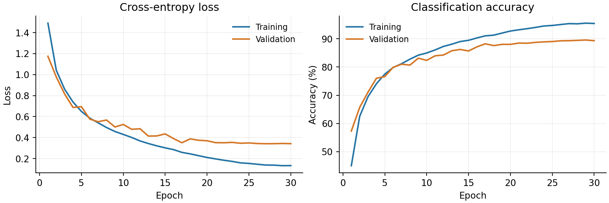

# 当代人工智能实验三：CIFAR-10 图像分类

**姓名：朱昕宇　学号：10245501426**

本仓库为《当代人工智能》实验三的代码与结果记录。本实验以基础 CNN 为起点，比较数据增强和残差注意力结构对图像分类效果的影响，并通过训练曲线、混淆矩阵、误分类样本及 Grad-CAM 分析模型的表现。两种网络均从随机初始化开始训练，未使用预训练权重。

## 1. 实验方法与设置

### 数据集与划分

使用 [CIFAR-10 官方数据集](https://www.cs.toronto.edu/~kriz/cifar.html)，图像大小为 32×32，共10类。将官方50,000张训练图像按类别分层划分为45,000张训练图像和5,000张验证图像，每类分别为4,500张和500张；官方10,000张测试图像每类1,000张。随机种子固定为42，三组实验使用相同划分，训练集和验证集索引互不重叠。

图像先转换为 `[0, 1]` 张量，再按通道标准化：均值为 `(0.4914, 0.4822, 0.4465)`，标准差为 `(0.2470, 0.2435, 0.2616)`。数据增强仅用于训练，验证和测试均不启用随机变换。

### 模型与对照实验

| 组别 | 模型 | 训练数据增强 | 对比目的 |
| --- | --- | --- | --- |
| A | 基础 CNN | 无 | 建立基准 |
| B | 基础 CNN | 补边4像素的随机裁剪、随机水平翻转 | 观察数据增强的影响 |
| C | 残差 SE-CNN | 与B组相同 | 比较组合架构改进的效果 |

- **基础 CNN**：包含3组卷积模块，每组为两层3×3卷积、ReLU和最大池化，通道数依次为32、64、128；分类头为全局平均池化、Dropout（0.3）和全连接层，共288,298个参数。
- **残差 SE-CNN**：包含卷积起始层和3个阶段，每阶段包含2个残差SE块，通道数依次为32、64、128；结合BatchNorm、SE通道注意力和Dropout（0.2），共707,874个参数。

三组均训练30轮，批量大小为128，采用AdamW、交叉熵损失、初始学习率0.001、权重衰减0.0005和余弦学习率调度，最低学习率为初始值的0.01倍。标签平滑和早停均关闭。CUDA训练使用自动混合精度和 `channels-last` 内存布局，数据加载进程数为0，PyTorch CPU线程数为4。

每组根据最高验证准确率保存最佳检查点，同分时保留较早轮次。全部训练完成后，分别在完整测试集上评估这些检查点，测试集不参与调参和模型选择。

## 2. 实验结果与分析

以下为在NVIDIA GeForce RTX 4060 Laptop GPU（8GB）上的实际结果。

| 组别 | 最佳轮次 | 验证准确率 | 测试准确率 | 宏平均F1 | 训练耗时 |
| --- | ---: | ---: | ---: | ---: | ---: |
| A 基础 CNN | 30 | 81.88% | 81.34% | 0.8132 | 3.23分钟 |
| B 基础 CNN + 增强 | 28 | 81.14% | 81.10% | 0.8108 | 5.41分钟 |
| C 残差 SE-CNN + 增强 | 29 | 89.56% | **88.74%** | **0.8869** | 11.30分钟 |

改进模型的测试准确率比基础模型提高7.40个百分点，同时参数量和训练耗时有所增加。单独加入数据增强后，测试准确率下降0.24个百分点；结合曲线，我认为增强提高了训练难度，在相同轮数下可能需要更长时间收敛，后续还需用验证集检验这一判断。

本次每组只采用一个随机种子，结果尚不能说明提升的统计稳定性。C组同时调整了残差结构、BatchNorm、SE和Dropout，因此结果反映的是组合改进效果，不能将全部提升归因于SE。

原始结果分别保存在 [A组](results/baseline/)、[B组](results/ablation/) 和 [C组](results/improved/) 目录。改进模型的训练曲线如下，完整混淆矩阵、逐类指标和误分类分析图见对应结果文件。



### 指标与可视化说明

| 文件 | 内容 |
| --- | --- |
| `summary.json`、`config.json` | 实验设置、参数量、运行环境、最佳验证轮次和训练耗时 |
| `split_indices.json` | 训练及验证索引、类别计数和划分哈希 |
| `history.csv`、`training_curves.png` | 各轮训练与验证的loss、accuracy及曲线 |
| `test_metrics.json` | 总准确率、每类准确率、precision、recall、F1和混淆矩阵 |
| `predictions.csv` | 全部10,000张测试图像的标签、预测、置信度和正确性记录 |
| `confusion_matrix.png` | 行为真实类别、列为预测类别的混淆矩阵，格内为样本数 |
| `misclassifications.png` | 预测置信度最高的12个错误样本，附索引、真实类别和预测类别 |
| `gradcam.png` | 3个错误样本和3个正确样本的预测类别Grad-CAM热图 |

总准确率为全部预测正确数除以测试样本总数。“每类准确率”采用该真实类别中预测正确的比例，即召回率；宏平均F1为十类F1的算术平均。高置信错误样本用于分析具体失败情况，不代表全部错误的分布。Grad-CAM使用末级空间卷积特征，改进模型选取最后残差块的 `conv2`；热图作为辅助解释，不视为因果证据。

## 3. 代码组织

```text
src/
  models.py              基础CNN、残差块及SE模块
  train.py               数据划分、训练、验证和检查点保存
  evaluate.py            测试评估、分类指标与可视化
tests/
  test_experiment.py     数据划分、指标、梯度和Grad-CAM检查
tools/
  verify_results.py      从保存的预测与日志独立核对结果
  download_data.py       官方数据归档的并行下载与MD5校验
  build_report.py        根据保存结果生成五页PDF报告
  package_submission.py  项目文件打包工具
results/
  baseline/              A组结果
  ablation/              B组结果
  improved/              C组结果
  verification.json     保存结果的核验记录
  environment_freeze.txt 本次运行环境的依赖版本
requirements.txt         直接依赖
run_experiments.ps1       原始三组训练与评估流程
```

仓库保留了实验配置、划分、日志、逐张预测和图表。原始数据可由程序下载，模型检查点可通过下述训练命令重新生成。

## 4. 运行环境

本次使用Windows 11、Python 3.12.14、PyTorch 2.6.0+cu124、torchvision 0.21.0+cu124和CUDA 12.4。依赖版本见 `requirements.txt`，完整环境记录见 `results/environment_freeze.txt`。项目建议使用Python 3.10–3.12。

以下命令在仓库根目录的Windows PowerShell中执行。首先创建环境：

```powershell
python -m venv .venv
.\.venv\Scripts\python.exe -m pip install --upgrade pip
```

有兼容NVIDIA显卡时，使用本次实验对应的CUDA版本：

```powershell
.\.venv\Scripts\python.exe -m pip install torch==2.6.0 torchvision==0.21.0 --index-url https://download.pytorch.org/whl/cu124
.\.venv\Scripts\python.exe -m pip install -r requirements.txt
```

CPU环境将上述第一条安装命令的索引地址改为 `https://download.pytorch.org/whl/cpu`，随后同样安装 `requirements.txt`。版本组合参照 [PyTorch官方安装说明](https://pytorch.org/get-started/previous-versions/)。下文的 `--device auto` 会根据环境选择CUDA或CPU。

## 5. 结果核验与实验复现

### 查看与核对已保存结果

CSV、JSON和PNG文件可直接查看，不需要重新训练。使用以下命令可从逐张预测重建混淆矩阵，并交叉检查分类指标、最佳验证轮次和训练/验证划分：

```powershell
.\.venv\Scripts\python.exe tools/verify_results.py
```

核验通过后更新 `results/verification.json`。该操作检查保存文件之间的一致性，不重新执行模型推理；若目录中存在 `best.pt`，还会核对检查点哈希与元数据。

### 重新运行三组完整实验

仓库的 `results/` 已含本次实验记录。训练程序会拒绝覆盖已有训练结果，以下命令将新结果写入 `results_reproduced/`，保留原始记录。再次复现时，可将 `$OutputRoot` 改为其他尚未使用的目录。

```powershell
$Python = (Resolve-Path .\.venv\Scripts\python.exe).Path
$DataDir = "./data"
$OutputRoot = "./results_reproduced"
$Experiments = @(
    @{ Name = "baseline"; Model = "baseline"; Augment = "none" },
    @{ Name = "ablation"; Model = "baseline"; Augment = "standard" },
    @{ Name = "improved"; Model = "improved"; Augment = "standard" }
)

foreach ($Experiment in $Experiments) {
    $TrainArgs = @(
        "-m", "src.train", "--model", $Experiment.Model,
        "--augment", $Experiment.Augment, "--data-dir", $DataDir,
        "--output-dir", "$OutputRoot/$($Experiment.Name)",
        "--epochs", "30", "--batch-size", "128", "--seed", "42",
        "--optimizer", "adamw", "--lr", "0.001", "--weight-decay", "0.0005",
        "--num-workers", "0", "--threads", "4", "--device", "auto", "--channels-last"
    )
    & $Python @TrainArgs
    if ($LASTEXITCODE -ne 0) { throw "Training failed: $($Experiment.Name)" }
}

foreach ($Experiment in $Experiments) {
    $ResultDir = "$OutputRoot/$($Experiment.Name)"
    & $Python -m src.evaluate --checkpoint "$ResultDir/best.pt" --data-dir $DataDir --output-dir $ResultDir --batch-size 128 --num-workers 0 --threads 4 --device auto
    if ($LASTEXITCODE -ne 0) { throw "Evaluation failed: $($Experiment.Name)" }
}

& $Python tools/verify_results.py --results-dir $OutputRoot
```

首次训练自动下载并解压CIFAR-10；已有数据时可修改 `$DataDir` 指向相应目录。官方下载较慢时，也可先运行 `.\.venv\Scripts\python.exe tools/download_data.py --data-dir ./data --workers 4` 下载并校验归档。`run_experiments.ps1` 记录相同的三组流程，但输出位置固定为 `results/`，适用于该目录尚无训练记录的情况。

本次三组纯训练合计约19.94分钟，不含下载、依赖安装和报告制作。运行耗时随硬件变化，GPU的非确定性算子也可能使重复训练指标出现小幅差异。`--deterministic` 可用于额外的确定性实验，本次记录未开启该选项。

### 核心行为检查

```powershell
.\.venv\Scripts\python.exe -m unittest discover -s tests -v
```

共6项检查，覆盖分层划分的数量与无交集、验证变换的独立性、手算分类指标、两个模型的反向梯度，以及Grad-CAM的空间输出和模型权重保持情况。检查不下载数据，也不启动完整训练。

## 6. 参考资料

1. Krizhevsky. *Learning Multiple Layers of Features from Tiny Images*, 2009. [CIFAR-10数据与技术报告](https://www.cs.toronto.edu/~kriz/cifar.html)。
2. He et al. *Deep Residual Learning for Image Recognition*, 2015. [arXiv:1512.03385](https://arxiv.org/abs/1512.03385)。
3. Hu et al. *Squeeze-and-Excitation Networks*, 2017. [arXiv:1709.01507](https://arxiv.org/abs/1709.01507)。
4. Selvaraju et al. *Grad-CAM: Visual Explanations from Deep Networks via Gradient-based Localization*, 2016. [arXiv:1610.02391](https://arxiv.org/abs/1610.02391)。
